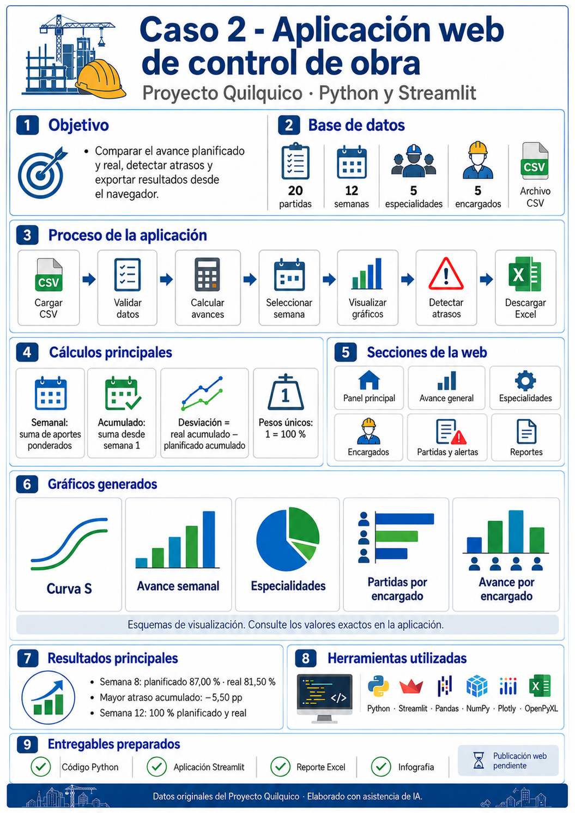

# Informe académico · Entregable 2

**Estudiante:** Martín Muñoz Hernandez. **Curso:** Python + IA para Programación, AECODE. **Caso:** 2, Desarrollo Web. **Proyecto:** Quilquico.

## Objetivo

Transformar el análisis de avance físico del Entregable 1 en una aplicación Streamlit que permita controlar semanas, comparar planificación y ejecución, detectar atrasos y exportar resultados desde el navegador.

## Metodología

Se revisaron las trece páginas de la pauta, el programa original, el CSV y las dos imágenes de evaluación. Se identificaron funciones reutilizables y el significado de cada variable antes de desarrollar. Los datos aportados contienen 240 registros (20 partidas por 12 semanas), cinco especialidades y cinco encargados. No se generaron registros ficticios.

La suma del plan semanal de cada partida coincide con su peso, demostrando que los avances son aportes ponderados al proyecto. Se conserva la suma por semana, la acumulación, la desviación real menos planificado y el conteo único de partidas. Los pesos se contabilizan una vez por código y se presentan en formato porcentual.

Se separó el procesamiento de la interfaz, se sustituyeron ventanas de gráficos por figuras Plotly y se convirtió la exportación a un archivo en memoria. El formulario manual valida la copia completa antes de aceptar cambios. Para evitar clasificaciones erróneas por aritmética de punto flotante se utiliza tolerancia de 1e-9; no se alteran los valores originales.

## Herramientas y funcionalidades

Python, Pandas y NumPy realizan el procesamiento; Streamlit organiza el panel, las entradas y las descargas; Plotly muestra gráficos interactivos; OpenPyXL construye el reporte. Las seis secciones cubren visión general, avance semanal/acumulado, especialidades, encargados, partidas/alertas y reportes. Se incluyen seis controles manuales y carga CSV. No se necesita servidor de base de datos.

## Resultados de la base original

| Corte | Planificado acumulado | Real acumulado | Desviación | Estado |
|---|---:|---:|---:|---|
| Semana 3 | 26,20 % | 24,00 % | −2,20 pp | Atrasada |
| Semana 5 | 49,60 % | 44,50 % | −5,10 pp | Atrasada |
| Semana 8 | 87,00 % | 81,50 % | −5,50 pp | Atrasada |
| Semana 11 | 97,00 % | 97,00 % | 0,00 pp | Según programa |
| Semana 12 | 100,00 % | 100,00 % | 0,00 pp | Según programa |

El cierre coincide con el plan, pero el seguimiento revela atrasos intermedios. La mayor desviación acumulada observada es −5,50 pp en la semana 8. Esta lectura evidencia la utilidad de revisar cada corte y distinguir desempeño semanal de acumulado.

## Mejoras respecto de la evaluación anterior

Se presentan pesos en porcentaje y se evita sumar su repetición semanal. El Excel añade comparación semanal a la Curva S, títulos, filtros, encabezados, paneles inmovilizados y formatos porcentuales. Las funciones se importan desde módulos reutilizables. Se integra una infografía creada con asistencia de IA que explica el flujo del código y muestra resultados originales.

## Validación y límites

Las pruebas comparan cinco funciones con las originales, verifican resultados conocidos y cortes, generan y reabren el Excel, construyen gráficos, rechazan datos inválidos y comprueban la edición transaccional. El detalle de ejecución y las limitaciones se registran en `VALIDACION.md`.

La aplicación interpreta el contrato de datos del proyecto: no es un importador universal de porcentajes internos. No estima causas del atraso ni predice fechas de término. Los cambios de sesión deben descargarse para persistir. El Excel es un reporte de resultados, no un modelo de recálculo; si cambia la base, debe regenerarse.

## Conclusiones

La adaptación mantiene los cálculos del primer entregable y facilita su utilización desde el navegador. La modularidad permite explicar y probar cada componente. Los resultados muestran que el cumplimiento final del programa no elimina la necesidad del control semanal. La publicación remota y el envío académico deben acreditarse por separado mediante una URL real y la entrega en Classroom.

